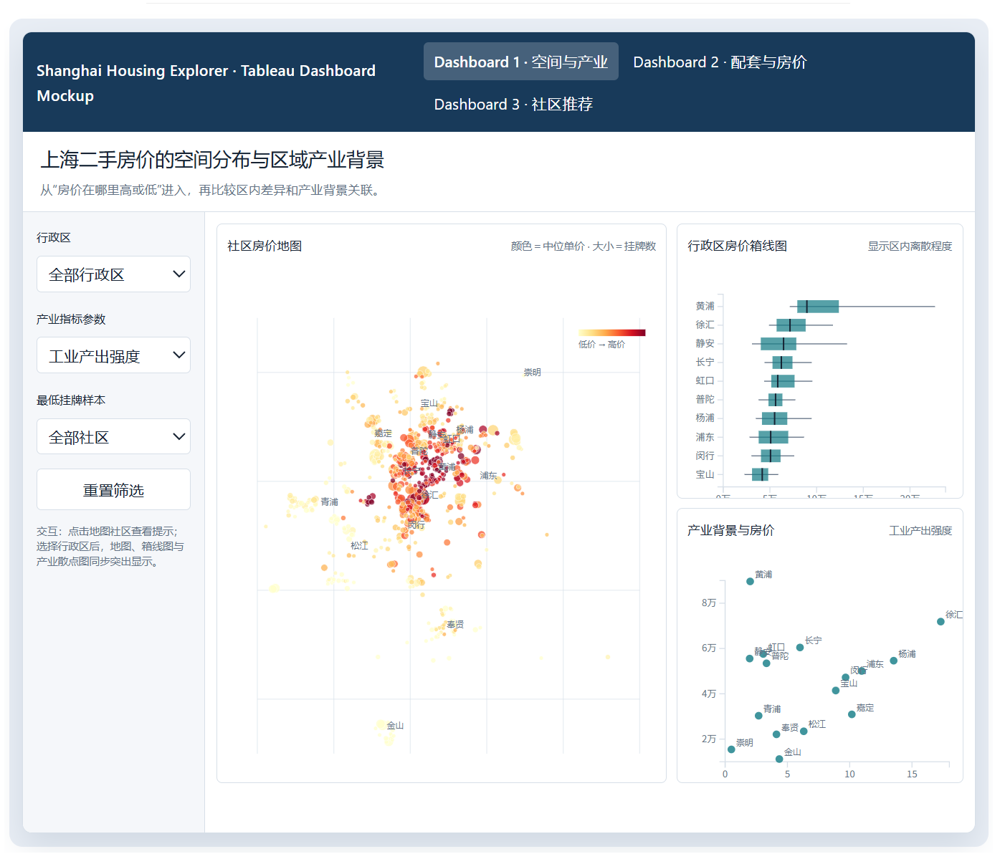
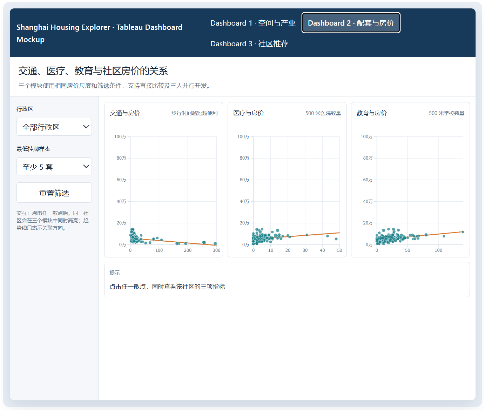
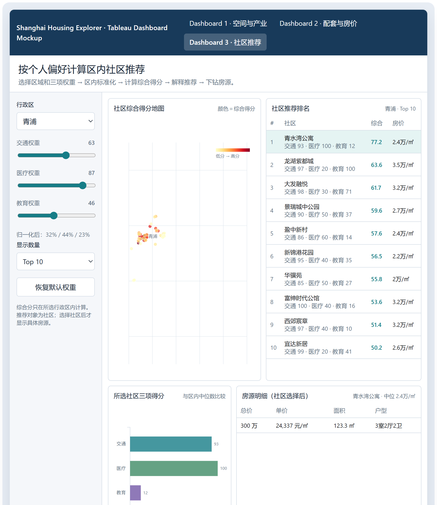

下面这部分只围绕项目目标、三个 Dashboard 的故事和实际实现方法展开。不会介绍 Tableau 或 Python 是什么，也不会加入无关的分析方向。

## Methodology（中文稿）

### 1. Tools and Approaches：使用的工具与可视化方法

本项目将以 **Tableau** 作为主要的可视化与交互分析工具，并使用 **Python** 完成数据清洗、地理编码结果整理、设施距离计算和分析表生成。最终分析将由三个相互衔接的交互式 Dashboard 构成。

在分析前，我们会先把房源层级的数据整理到适合各项分析的粒度：

- 房源数据用于计算每个社区的房价中位数、房源数量和价格分布。
- 地铁数据用于计算每个社区到最近地铁站的步行时间。
- 医疗和教育设施数据用于计算每个社区一定范围内的医院和学校数量。
- 区级产业数据用于描述不同区域的产业背景，包括工业、建筑业和服务业指标。
- 推荐功能以社区为分析单位，在用户选定的行政区内计算交通、医疗和教育排名。

选择社区房价中位数作为主要价格指标，是因为个别异常昂贵或异常便宜的房源可能明显影响平均数，而中位数更适合表示一个社区的典型挂牌价格。房源数量将同时显示，用于提醒用户某些社区的价格结论可能来自较少的房源样本。

---

### 2. Justification：方法与项目目标的对应关系

#### Dashboard 1：地理位置、产业背景与房价

*图 1. Dashboard 1 界面设计：社区房价地图、行政区房价箱线图及产业背景与房价散点图。*

第一个 Dashboard 的目标是回答：

> 上海的高价和低价社区分布在哪里？不同区域的房价分布有何差异？这些差异与区域产业背景之间是否存在可观察的关系？

我们将使用以下图表：

1. **社区房价地图**

   地图上的每个点代表一个社区，点的位置由社区经纬度确定，颜色表示社区房价中位数，点的大小表示该社区的房源数量。地图能够直接呈现房价的空间集聚情况，例如高价社区是否集中在中心城区、低价社区是否主要分布在外围地区。

2. **行政区房价箱线图**

   箱线图展示各行政区内部社区房价的中位数、四分位范围和异常值。只比较各区平均房价会掩盖区内差异，因此箱线图可以进一步说明，同一区域内部是否同时存在高价和低价社区，以及不同区域的价格分布是否稳定。

3. **房价与产业指标散点图**

   每个点代表一个行政区，横轴显示用户选择的产业指标，纵轴显示该区的社区房价中位数。产业指标包括工业产出强度、建筑业产出强度和服务业经营收入强度。用户可以通过参数切换产业指标，观察不同产业背景与区域房价之间的关系。

产业指标只在行政区层级使用，作为解释区域差异的背景信息。该图用于识别关联模式，不把产业指标解释为房价变化的直接原因。

地图适合回答“房价在哪里高或低”，箱线图适合回答“各区内部的价格差异有多大”，散点图适合回答“区域房价与产业背景是否同时变化”。三种图表分别处理空间分布、价格分布和区域背景，因此不会重复表达同一信息。

---

#### Dashboard 2：交通、医疗、教育与房价

*图 2. Dashboard 2 界面设计：并列比较交通、医疗和教育条件与社区房价的关系。*

第二个 Dashboard 的目标是回答：

> 社区周边的交通、医疗和教育条件与房价之间分别存在什么关系？哪一种设施条件与房价的关系更明显？

Dashboard 将设置三个并列模块，并使用一致的图表结构：

1. **交通与房价**

   - 横轴：社区到最近地铁站的步行时间；
   - 纵轴：社区房价中位数；
   - 每个点：一个社区；
   - 趋势线：显示步行时间与房价的整体关系。

   该图用于判断距离地铁较近的社区是否通常具有更高的房价。由于步行时间越短表示交通便利程度越高，图表会在标题和提示信息中明确指标方向。

2. **医疗与房价**

   - 横轴：社区周边500米范围内的医院数量；
   - 纵轴：社区房价中位数；
   - 每个点：一个社区；
   - 趋势线：显示医疗设施数量与房价的整体关系。

   该图用于判断医疗设施较多的社区是否呈现更高的房价，但不会把医院数量直接解释为医疗服务质量。

3. **教育与房价**

   - 横轴：社区周边500米范围内的学校数量；
   - 纵轴：社区房价中位数；
   - 每个点：一个社区；
   - 趋势线：显示教育设施数量与房价的整体关系。

   该图用于观察教育设施的空间可达性与社区房价之间是否存在关联，但学校数量只表示设施接近程度，不代表学校质量或学区资格。

三个模块采用相同的纵轴、颜色编码和社区筛选方式，使用户可以直接比较交通、医疗和教育三个因素。点的大小表示房源数量，低样本社区将使用较低透明度，避免少量房源形成的价格中位数被误认为稳定结果。

用户选择地图上的行政区或使用区域筛选器后，三个模块将同时更新。点击某个社区时，其他图表会突出显示同一社区，从而帮助用户比较该社区在三个方面的表现。

采用三个并列散点图，是因为项目需要分析三个设施指标与房价之间各自的关系。把三种指标混合在一张图中会导致单位、方向和含义不一致，难以解释。并列设计既方便三位成员分别完成交通、医疗和教育分析，也能在最终 Dashboard 中形成统一的比较结构。

---

#### Dashboard 3：基于个人偏好的社区推荐

*图 3. Dashboard 3 界面设计：根据交通、医疗和教育权重生成社区排名并下钻至房源。*

第三个 Dashboard 的目标是把前两个 Dashboard 的观察转化为一个可操作的决策过程：

> 当用户已经确定希望居住的行政区，并且对交通、医疗和教育有不同偏好时，哪些社区最符合其需求？

选择“社区推荐”作为主要输出比“房源推荐”更合适。交通、医疗和教育指标都是社区周边环境指标，同一社区内的房源通常共享这些条件。如果直接对房源排名，同一个社区的多套房源可能占据推荐榜前列，使结果重复。用户选定推荐社区后，再查看该社区内的具体房源，逻辑更加清楚。

用户需要完成以下操作：

1. 选择一个行政区；
2. 设置交通、医疗和教育三个偏好权重；
3. 系统在所选行政区内部对社区进行排名；
4. 根据权重重新计算综合得分；
5. 输出推荐社区；
6. 用户选择社区后，再查看该社区内的具体房源。

三个指标将先转换为方向一致的标准化分数：

- 地铁步行时间越短，交通分数越高；
- 500米内医院数量越多，医疗分数越高；
- 500米内学校数量越多，教育分数越高。

为避免不同指标的单位影响计算，我们会在用户选择的行政区内部，把三项指标分别转换为0至100分。综合推荐分数计算为：

\[
综合得分=
交通分数\times交通权重+
医疗分数\times医疗权重+
教育分数\times教育权重
\]

三个权重将先除以其总和，因此即使用户输入的权重之和不等于100，系统仍能计算可比较的综合得分。当某项指标在所选区域内没有差异时，该项统一赋予中间分数，避免除以零。

推荐 Dashboard 将包含：

1. **社区综合得分地图**

   地图颜色表示综合得分，使用户可以看到高分社区在所选行政区内的具体位置。

2. **社区推荐排名表**

   排名表显示社区名称、综合得分、交通分数、医疗分数、教育分数、社区房价中位数和房源数量。用户不仅可以看到最终排名，也可以理解每个社区获得该排名的原因。

3. **社区指标比较图**

   用户点击某个社区后，图表显示该社区的三项分数，并与所选行政区的中位水平进行比较。该图用于解释推荐结果，避免系统只给出一个无法理解的总分。

4. **房源明细表**

   当用户选定社区后，明细表列出该社区内的具体房源，包括挂牌总价、单位价格、面积、户型和房源链接。房源表作为推荐后的进一步查询结果，不参与社区综合得分计算。

权重参数适合这个目标，因为不同用户对交通、医疗和教育的重视程度不同。动态排名能够展示偏好变化如何改变推荐结果，使 Dashboard 从静态描述转变为个人决策工具。

---

### 3. Step-by-step Approach：完整故事与实现步骤

整个项目按照“发现差异—解释关系—支持选择”的顺序展开。

#### 第一步：确定分析单位并整理数据

我们首先清理重复记录、缺失价格、无效面积和异常坐标，并统一行政区和社区名称。随后以社区为单位计算：

- 社区房价中位数；
- 社区房源数量；
- 社区经纬度；
- 到最近地铁站的步行时间；
- 500米内医院数量；
- 500米内学校数量。

区级产业数据按行政区连接，只用于第一个 Dashboard 的区域背景分析。房源明细保留在原始粒度，用于第三个 Dashboard 的最终下钻查询。

#### 第二步：展示上海房价的空间差异

用户首先从社区房价地图观察高价和低价社区的空间分布，再通过行政区箱线图判断各区内部的价格差异。选择某个行政区后，地图和箱线图同步更新。

随后，用户通过产业参数切换工业、建筑业和服务业指标，观察区域产业背景与房价中位数的关系。第一部分由此建立项目的空间背景：房价并非在上海均匀分布，不同行政区之间以及同一区内部都存在明显差异。

#### 第三步：分析生活设施与房价的关系

在了解房价分布后，用户进入第二个 Dashboard，分别查看交通、医疗和教育指标与房价之间的关系。

三个图表采用一致的视觉结构，使用户能够比较：

- 地铁步行时间增加时，房价是否出现下降趋势；
- 医院数量增加时，房价是否出现变化；
- 学校数量增加时，房价是否出现变化；
- 这些关系在不同区域是否一致；
- 结论是否受到低样本社区或异常值影响。

这一步不会声称交通、医院或学校直接造成房价变化，而是识别它们与房价之间的可观察关联。

#### 第四步：把分析结果转化为社区推荐

用户在第三个 Dashboard 中选择行政区，并设置三项偏好权重。系统只在该行政区内部比较社区，因此不会让中心城区和外围城区因整体价格及资源差异而直接竞争。

系统先计算三项标准化分数，再根据用户权重计算综合得分和区内排名。地图展示高分社区的位置，排名表给出具体顺序，比较图解释各社区的优势和不足。

例如，当用户提高交通权重时，靠近地铁站的社区排名应当上升；提高教育权重时，学校数量较多的社区排名应当上升。通过观察权重变化前后的排名变化，可以验证推荐系统是否按照用户偏好工作。

#### 第五步：从社区推荐下钻到房源查询

用户选择推荐社区后，Dashboard 显示该社区的挂牌房源。用户可以查看房源的价格、面积和户型，并判断推荐社区内是否存在符合自身预算和居住需求的房源。

项目故事最终形成以下完整路径：

> 上海房价在哪里高或低  
> → 区域内部存在多大差异  
> → 产业背景与区域房价有什么关联  
> → 交通、医疗和教育分别如何关联房价  
> → 在指定区域和个人偏好下，哪些社区更合适  
> → 推荐社区中有哪些具体房源可供进一步查看

该方法使三个 Dashboard 分别承担空间发现、关系分析和决策支持的任务，同时共享行政区、社区、房价和生活设施指标，从而形成连续而完整的分析故事。
